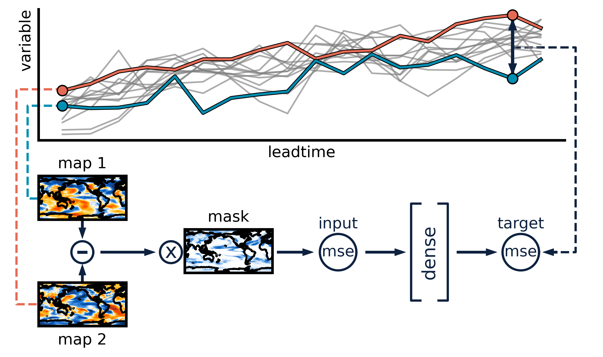

<h1 align="center">analog forecasting with a machine learning mask</h1>

*code base for paper xxx:
regional climate predictions on multi-year to decadal time scales using an analog forecasting approach with a machine learning derived mask of weights, which highlights the most important precursor regions for matching analogs to prediction states*

***
<p align="center">
  
</p>


**the above schematic shows the machine learning component of the full prediction framework:**
- two maps are taken (not necessarily from the same model, member, or time) and scaled by a randomly initialized mask of weights
- the mean-squared-difference between the weighted maps is passed to a linear node that predicts the target region mean-squared-difference at a future time
- the randomly initialized mask of weights is updated through training until there is a strong correspondence between input (global) mse and output (target region) future mse
- the final mask of weights can then be used in an analog forecasting framework


***
<p align="center">
  
</p>


**the above schematic shows the analog matching step of the full prediction framework:**
- both observations and the library of potential analogs are weighted by the learned global mask of weights
- each state in the weighted potential analog library is compared to a weighted observation state (for example, the one at year index 0 in the figure above)
- the weighted potential analog states that have the lowest mean-squared difference to the weighted observed state are the best matches and are used for prediction
- this matching can be done using a trajectory of states, such that a time series of potential analog states can be compared to a time series of observed states (example shown in the figure is for a 3 year time series)
- whether matching on a single state or a time series of states, the predictions are the future (green box in the figure, based on selected lead time) of the best matching analogs, so some potential analogs must be omitted (ones that do not have the requested future states, red box in the figure)


> [!NOTE]
> this code base has been written to use yearly data, which can come from either earth system models or observations

<h2 align="center">code usage</h2>

- run_predictions.py requires preprocessed data to define and run a new experiment, given region(s), variable, and lead time(s)
- new_experiment.ipynb runs the full framework, from preprocessing data to defining a new experiment to learning the mask and identifying the best analogs
- once analogs are saved from using one of the two options above, the function get_targets in best_analogs.py can be used to extract the predictions and truth for analysis

<p align="center">
<ins>example mask of weights</ins>
</p>
<p align="center">

</p>

<h2 align="center">python packages</h2>

> [!IMPORTANT]
> most of the following packages require the conda-forge channel, versions given below are sufficient, but not necessarily required
```bash
conda create --name analog-env python=3.11.4
conda config --add channels conda-forge
conda activate analog-env

conda install cartopy=0.22.0 esmf=8.4.2 hdf5=1.14.1 json5=0.9.14 matplotlib=3.7.2 regionmask=0.10.0 xarray=2023.7.0 xesmf=0.7.1 pip=23.2.1

pip install numpy==1.24.3 tensorflow==2.13.0 tensorflow-macos==2.13.0 silence-tensorflow==1.2.1 keras==2.13.1 geopandas==0.13.2 ipykernel cftime
```

<h2 align="center">references</h2>

***
[Rader, Jamin K., and Elizabeth A. Barnes. 2023. “Optimizing Seasonal-To-Decadal Analog Forecasts With a Learned Spatially-Weighted Mask.” Geophysical Research Letters 50 (23): e2023GL104983.](https://doi.org/10.1029/2023GL104983)


